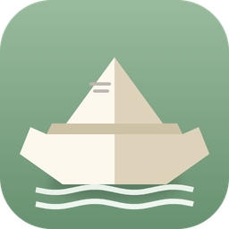
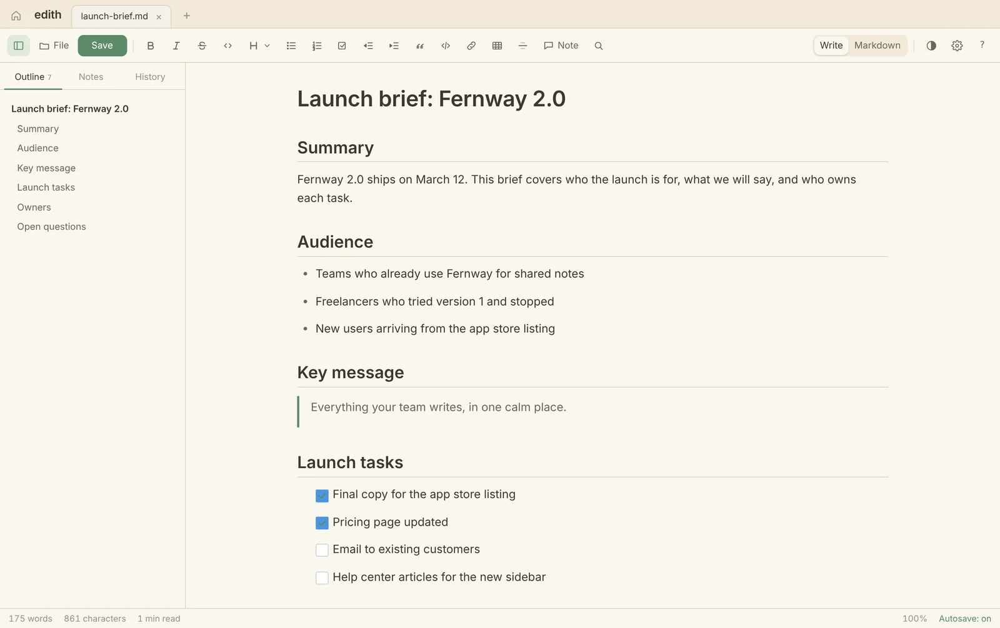

<p align="center"></p>

<h1 align="center">Edith</h1>

<p align="center"><b>Your Markdown files, finally readable.</b><br>A free Mac app for reading and revising Markdown as if it were an ordinary document.</p>

<p align="center"><a href="https://github.com/Dylan-Ashton/edith/releases/latest"><b>Download for Mac</b></a> · <a href="https://dylan-ashton.github.io/edith/">Website</a> · <a href="CHANGELOG.md">Changelog</a></p>



## What it does

- **Write like in any document.** Headings, lists, checklists and tables render as you read them. Google Docs shortcuts and Markdown typing shortcuts both work.
- **Markdown when you want it.** Switch to the raw source with a live preview. Both views edit the same file.
- **Notes, then AI.** Leave notes on any passage. **Copy as prompt** (⇧⌘R) turns them into one message for any AI chat. Notes are kept by Edith, not written into your file.
- **Nothing gets lost.** Automatic version history with a line-by-line compare, autosave into the same file, crash recovery, and a guard that asks before overwriting a file another app changed.
- **Opens more than Markdown.** Word, PDF, HTML and RTF files convert to Markdown on your Mac.
- **Private by design.** No account, no analytics, no AI service built in. The only network request is the check for a newer version.

## Install

Requires an Apple Silicon Mac (M1 or newer) with macOS 13 Ventura or later.

1. Download **Edith (Apple Silicon).zip** from the [latest release](https://github.com/Dylan-Ashton/edith/releases/latest) and unzip it.
2. Double-click **Install Edith**. It copies Edith into Applications and opens it.
3. If macOS says it cannot verify the installer, open **System Settings → Privacy & Security**, click **Open Anyway**, and double-click it again. Edith is not yet notarized by Apple, so this is needed once.

Edith checks for new versions when it opens. To update, run the new installer; settings, history and open tabs carry over.

## Build from source

```
npm install
npm run build     # builds dist.html and electron-app/index.html
npm run dev       # runs the app (Mac)
npm test          # browser tests (run `npx playwright install chromium` first)
```

Edith is an Electron app built on [Toast UI Editor](https://github.com/nhn/tui.editor) and ProseMirror, with Turndown, mammoth and pdf.js for conversion. [CONTRIBUTING.md](CONTRIBUTING.md) covers the architecture, tests and release process. Release builds are made by GitHub Actions on an Apple Silicon runner when a `v*` tag is published.

## Feedback

Found a bug or want a feature? [Open an issue](https://github.com/Dylan-Ashton/edith/issues/new/choose), or use Help → Report a Problem… in the app. Security problems: see [SECURITY.md](SECURITY.md).

## License

[MIT](LICENSE) © 2026 Dylan Ricci. The fonts bundled in the app and used on the website (IBM Plex and the theme fonts) are under the SIL Open Font License; see [fonts/LICENSES.md](fonts/LICENSES.md).
